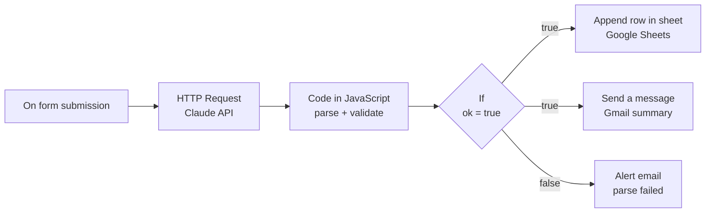
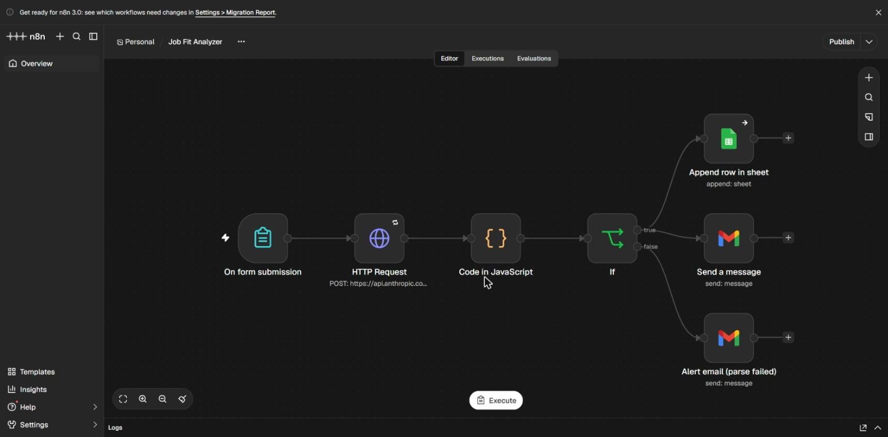
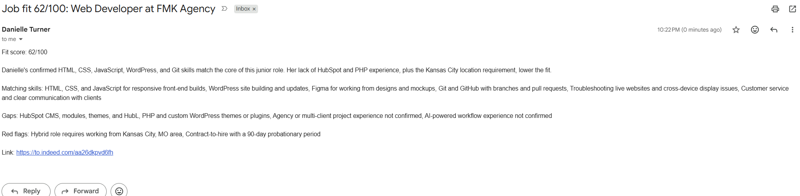
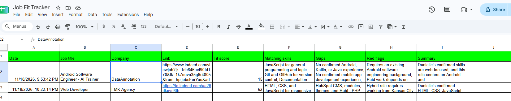

# Job Fit Analyzer

An [n8n](https://n8n.io) workflow that scores a job posting against my **confirmed** skills using the Claude API, logs the result to Google Sheets, and emails me a summary.

I built it to stop guessing whether a posting is worth my time, and to practice building a real automation end to end: input form, API call, validation, storage, notification, and error handling.

## What it does

1. I paste a job title, company, link and description into an n8n form.
2. The workflow sends the posting to Claude with a system prompt that lists my confirmed skills (and the skills I am **not** confident in yet).
3. Claude replies with JSON: `fit_score` (0-100), `matching_skills`, `gaps`, `red_flags`, `summary`.
4. A Code node checks that the reply is valid JSON with the expected fields.
5. If it is valid, the workflow appends a row to a Google Sheet and sends me a plain-text summary email.
6. If it is not valid, it sends me an alert email with the raw reply instead, and no row is added.

## Workflow diagram



## Screenshots

| n8n canvas | Summary email |
|---|---|
|  |  |



## Nodes

| Node | What it does |
|---|---|
| On form submission | Form with Job title, Company, Link (optional), Description |
| HTTP Request | `POST https://api.anthropic.com/v1/messages` with model `claude-haiku-5-5`. Retry on fail is on (3 tries). |
| Code in JavaScript | Finds the text block in Claude's reply, strips code fences, parses JSON, checks `fit_score` is 0-100 and the arrays/summary are present. Returns `ok: true/false`. |
| If | Routes on `ok` |
| Append row in sheet | Adds Date, Job title, Company, Link, Fit score, Matching skills, Gaps, Red flags, Summary. Set to continue on error so the email still sends. |
| Send a message | Plain-text summary email |
| Alert email (parse failed) | Sent only when the reply could not be read |

## Prompt design

The system prompt (inside the HTTP Request node) does five things:

- Lists my confirmed skills and says those are the **only** skills Claude may credit me with.
- Lists skills I am not confident in yet and tells Claude to treat them as gaps.
- Defines a scoring rubric (0-30 poor, 31-60 partial, 61-80 good, 81-100 excellent), judged mainly on required skills.
- Says what counts as a red flag (state residency rules, required degree or license, years of experience I lack, phone-heavy support, on-call or night shifts) and that my local area is not one.
- Treats the job description as untrusted text and tells Claude to ignore any instructions inside it.

To use this for yourself, **edit the skills list in that prompt**. It describes me, not you.

## Setup

You need: n8n (I ran it with `npx n8n` in a GitHub Codespace), a Claude API key, and a Google account.

1. Start n8n:
   ```bash
   npx n8n
   ```
2. In n8n, **Import from file** and choose `workflow/job-fit-analyzer.json`.
3. Create credentials in n8n (they are **not** in this repo):
   - **Anthropic**: your API key, on the HTTP Request node.
   - **Google Sheets** (OAuth2): create a Google Cloud project, enable the Sheets, Drive and Gmail APIs, and create OAuth clients. Add the redirect URL n8n shows you.
   - **Gmail** (OAuth2): same project.
4. Create a Google Sheet with these headers in row 1: `Date, Job title, Company, Link, Fit score, Matching skills, Gaps, Red flags, Summary`. Select it in the Sheets node (the exported file has `YOUR_GOOGLE_SHEET_ID` as a placeholder).
5. Set the **To** address in both Gmail nodes (the export has `YOUR_EMAIL@example.com`).
6. Click **Execute workflow**, open the form's Test URL, and submit a posting.

## Cost and limits

- Each run is one small API call. I set a spending limit on my Anthropic account.
- The Form Trigger test URL only listens while you click Execute workflow. I have not set this up for always-on use (it would need publishing and a running n8n server).
- Scores vary slightly between runs of the same posting. The rubric reduced the swing but did not remove it. Treat the score as a rough guide.
- It only knows the skills in the prompt. If the skills list is out of date, the scores will be too.

## Security notes

- No API keys, OAuth secrets or tokens are in this repo. Credentials stay in n8n.
- The exported workflow has credential IDs, the sheet ID and email address replaced with placeholders.
- `.gitignore` excludes n8n data, `.env` files and Google client secret files.

## What I learned

See [docs/portfolio-writeup.md](docs/portfolio-writeup.md).

## Tech

n8n, Claude API (Anthropic), Google Sheets, Gmail, JavaScript.
